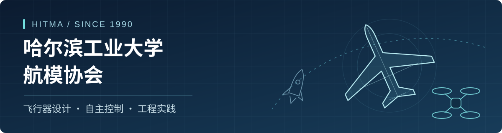
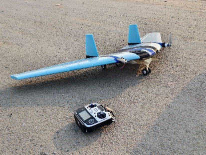
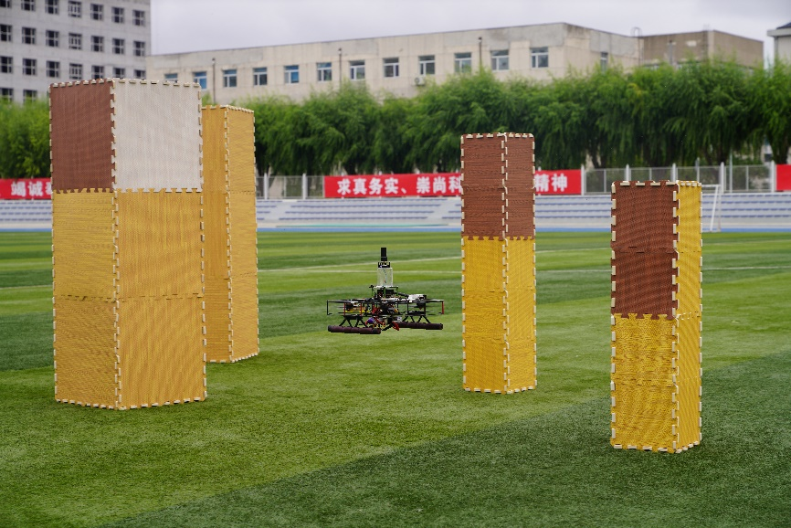

  

  <a href="#协会简介">协会简介</a> ·
  <a href="#项目方向">项目方向</a> ·
  <a href="#培养与实践">培养与实践</a> ·
  <a href="#竞赛成绩">竞赛成绩</a> ·
  <a href="#开放协作">开放协作</a>

## 协会简介

**哈尔滨工业大学航模协会（HITMA）成立于1990年，是在哈尔滨工业大学航天学院指导下开展活动的学生科技团队。**

我们围绕固定翼、多旋翼和模型火箭，开展飞行器设计、制作、控制与试验。成员在气动分析、结构设计、飞行控制、嵌入式开发和机器视觉等方向协作，通过科创竞赛、科研合作与科普活动，把课堂知识用到实际项目中。

这里汇集协会的项目代码、技术文档和学习资料，欢迎交流学习、共同维护。

<table>
  <tr>
    <td width="50%" align="center">
       
      固定翼飞机设计与制作
    </td>
    <td width="50%" align="center">
       
      四旋翼无人机自主飞行试验
    </td>
  </tr>
</table>

## 项目方向

协会的竞赛与研究覆盖飞行器总体设计、结构制造、电控开发及自主飞行等环节。

| 项目方向 | 主要内容 |
| --- | --- |
| **超轻质量大负载固定翼** | 轻量化设计、载荷能力优化与载荷投放。 |
| **限时载运飞行** | 围绕载运任务，优化总体布局、结构、动力匹配与飞行效率。 |
| **滑翔机控制飞行** | 滑翔机设计、操纵控制与任务飞行。 |
| **固定翼无人机侦察与打击** | 目标识别、任务规划与全流程自主飞行。 |
| **智能四旋翼无人机** | 自主识别、避障、轨迹规划与跟踪、多机协同。 |
| **多级模型火箭** | 箭体与电控设计、高度控制、载荷回收。 |
| **太阳能无人机** | 太阳能供能、能源管理与长航时飞行。 |
| **机翼静载挑战** | 结构设计、力学仿真、轻量化制造与静力加载试验。 |

## 培养与实践

协会采用 **“1+2+N”科创人才培养模式**，将基础学习、动手实践与项目协作结合起来。

| 1 系列理论培训 | 2 板块实践提升 | N 团队个性发展 |
| --- | --- | --- |
| 通识安全、气动总体、结构设计、飞控、编程与嵌入式等。 | 电子工艺实践与制造工艺实践，在焊接、装配和制作中积累经验。 | 根据兴趣参与竞赛与创新项目，在团队协作中持续深入。 |

**科研与创新**：结合校内实验室合作，开展无人机智能控制、复合材料结构与智能传感等研究，鼓励成员探索创新作品与成果转化。

**科普与交流**：参与航天日活动、航模飞行表演、模型制作体验、高校科学营与社区科普，向更多人介绍航空航天知识。

## 竞赛成绩

中国大学生飞行器设计创新大赛（CUADC）：

| 年份 | 一等奖 | 二等奖 | 三等奖 | 合计 |
| --- | ---: | ---: | ---: | ---: |
| **2026** | **6** | **2** | **7** | **15** |
| 2025 | 1 | 1 | 8 | 10 |

按赛事年份统计；2026年数据包含团体奖。

## 开放协作

我们通过 GitHub 沉淀项目成果、记录技术问题和维护版本，让后续成员能够理解、复现并继续改进已有工作。

| 入口 | 用途 |
| --- | --- |
| [协会项目仓库](https://github.com/orgs/HITMA2026/repositories) | 浏览已公开的项目与资料。 |
| [仓库建设与协作规范](https://github.com/HITMA2026/.github/blob/main/docs/repository-standard.md) | 了解项目组织、使用说明、版本与验证记录的要求。 |
| [README 范本](https://github.com/HITMA2026/.github/blob/main/templates/README-template.md) | 新建或整理项目首页。 |
| [贡献与协作说明](https://github.com/HITMA2026/.github/blob/main/CONTRIBUTING.md) | 参与代码、硬件与文档维护。 |
| [验证记录范本](https://github.com/HITMA2026/.github/blob/main/templates/validation-record-template.md) | 记录仿真、台架或实机验证结果。 |

欢迎对航模、无人机和工程实践感兴趣的同学与我们交流。项目问题请优先在对应仓库提出，主页与公共资料的建议可通过 [Issues](https://github.com/HITMA2026/.github/issues) 反馈。
